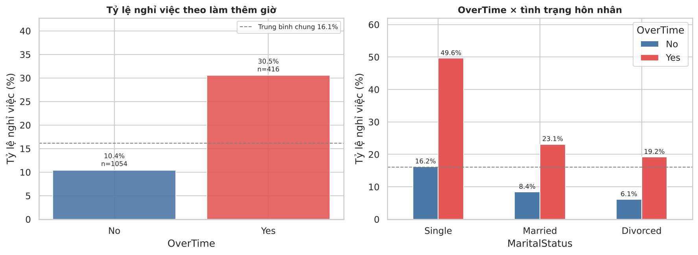
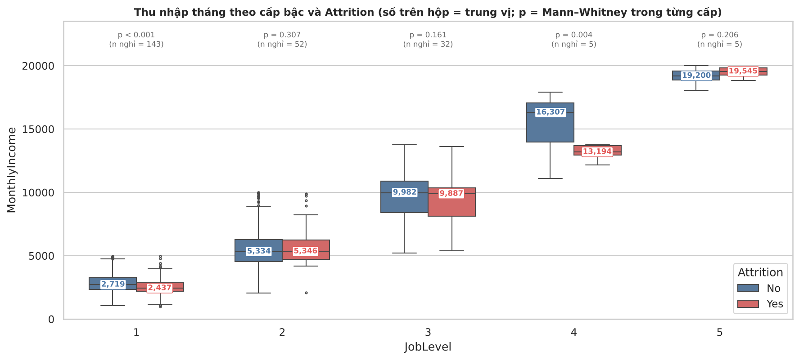
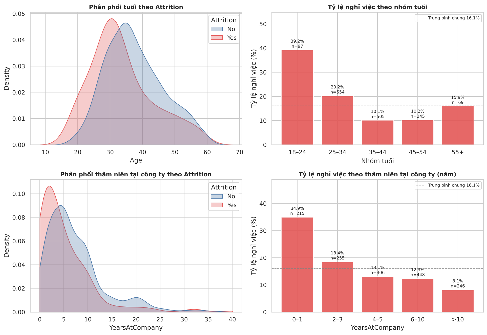
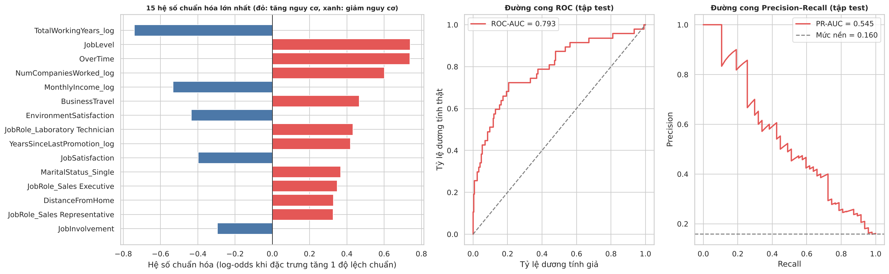

# Phân tích nghỉ việc của nhân viên — IBM HR Analytics (Mid-Term 2)

Bài tập giữa kỳ 2 môn **Khoa học dữ liệu**. Notebook Python phân tích tập dữ liệu
[IBM HR Analytics Employee Attrition & Performance](https://www.kaggle.com/datasets/pavansubhasht/ibm-hr-analytics-attrition-dataset)
theo đúng **4 giai đoạn** của đề bài: đánh giá dữ liệu → làm sạch → phân tích và kiểm định giả thuyết → khuyến nghị.

**Câu hỏi nghiên cứu:** những yếu tố nào liên quan đến việc nhân viên nghỉ việc (`Attrition`), và doanh nghiệp nên làm gì để giữ chân họ?

Báo cáo đầy đủ nằm trong file **`Bao_cao_HR_Attrition.pdf`**; README này mô tả cách chạy code và cách đọc kết quả.

## 1. Cấu trúc project

```
hr-attrition-analysis/
├── HR_Attrition_Analysis.ipynb              # Notebook chính: toàn bộ 4 giai đoạn, có chú thích từng khối lệnh (đã chạy sẵn kết quả)
├── WA_Fn-UseC_-HR-Employee-Attrition.csv    # Dữ liệu gốc (1.470 dòng x 35 cột)
├── Bao_cao_HR_Attrition.pdf                 # Báo cáo phân tích chính thức
├── generate_report.py                     # Script dựng báo cáo PDF từ figures/ và outputs/ (ReportLab)
├── report_config.py                       # Thông tin nhóm, giảng viên, link GitHub, tên file logo hiển thị trên bìa
├── fonts/                                 # Font DejaVu Sans (hỗ trợ đầy đủ tiếng Việt và ký hiệu toán)
├── requirements.txt                         # Thư viện cần cho chạy local
├── figures/                                 # 17 biểu đồ (PNG) do notebook sinh ra
│   ├── fig01_attrition_distribution.png     #   GĐ1: phân phối biến mục tiêu
│   ├── fig02..fig03_*.png                   #   GĐ2: outlier, biến đổi log
│   ├── fig04..fig14_*.png                   #   GĐ3: sàng lọc biến, H1–H8, heatmap
│   ├── fig06b_income_by_joblevel.png        #   GĐ3: thu nhập theo từng cấp bậc × Attrition (kiểm soát nhiễu H2)
│   ├── fig15_logreg.png                     #   GĐ3: hệ số chuẩn hóa, ROC, Precision–Recall
│   └── fig16_risk_segments.png              #   GĐ4: phân khúc rủi ro
└── outputs/                                 # Bảng kết quả do notebook sinh ra
    ├── screening_tests.csv                  #   30 kiểm định + p hiệu chỉnh Bonferroni và FDR
    ├── hypothesis_summary.csv               #   tổng hợp kiểm định các giả thuyết (Bonferroni + FDR)
    ├── outlier_table.csv                    #   bảng outlier theo IQR / Z-score
    ├── logreg_coefficients.csv              #   hệ số hồi quy logistic (gốc và chuẩn hóa)
    ├── topk_risk.csv                        #   precision/recall khi chọn top-k% nhân viên rủi ro nhất
    ├── risk_segments.csv                    #   các phân khúc rủi ro (tỷ lệ, lift, độ bao phủ)
    ├── hr_attrition_model_ready.csv         #   dữ liệu sau mã hóa (44 cột)
    └── results.json                         #   số liệu tổng hợp (gồm CMH, VIF, AUC lặp lại...)
```

Thư mục `figures/` và `outputs/` được notebook **tự tạo lại** mỗi lần chạy.

## 2. Chạy project

### 2.1 Trên Google Colab (khuyến nghị)

1. Vào https://colab.research.google.com → **File → Open notebook → GitHub**, dán link repo và chọn `HR_Attrition_Analysis.ipynb`.
2. Notebook cần file CSV. Ở cell **`0.2 Đọc dữ liệu`**, điền link raw của file CSV trong repo vào biến `GITHUB_RAW_URL`:
   ```python
   GITHUB_RAW_URL = "https://raw.githubusercontent.com/<user>/<repo>/main/WA_Fn-UseC_-HR-Employee-Attrition.csv"
   ```
   Khi đã điền link này, **Runtime → Run all** chạy từ đầu đến cuối mà không cần thao tác tay.
   Nếu để trống, notebook sẽ hiện nút *Choose Files* để bạn tải file CSV lên.
3. Chọn **Runtime → Run all**. Toàn bộ thư viện (kể cả `statsmodels`) đã có sẵn trên Colab.

### 2.2 Trên máy cá nhân

```bash
cd hr-attrition-analysis
pip install -r requirements.txt
jupyter notebook HR_Attrition_Analysis.ipynb
```

Rồi chọn **Kernel → Restart & Run All**. File CSV phải nằm **cùng thư mục** với notebook
(notebook báo lỗi rõ ràng nếu không tìm thấy). Yêu cầu Python 3.10 trở lên.

Notebook cố định `random_state = 42` nên kết quả tái lập được. Đã kiểm tra chạy hết không lỗi với
**pandas 2.2** (như Colab) và **pandas 3.0**; scikit-learn 1.9, statsmodels 0.15, seaborn 0.13.

> **Lưu ý:** cell nào báo `NameError: name 'df' is not defined` nghĩa là cell `0.2` (đọc dữ liệu) chưa chạy thành công; hãy chạy lại cell đó trước.

### 2.3 Dựng lại báo cáo PDF

Báo cáo `Bao_cao_HR_Attrition.pdf` được sinh tự động từ kết quả của notebook nên số liệu luôn khớp:

1. Chạy notebook (Run all) để tạo `figures/` và `outputs/`.
2. Sửa thông tin nhóm, giảng viên, link GitHub trong `report_config.py`; đặt `logo_truong.png` và `logo_aep.png` cạnh script.
3. Chạy:
   ```bash
   pip install reportlab pillow pandas
   python generate_report.py
   ```

## 3. Dữ liệu

| Hạng mục | Mô tả |
|---|---|
| Nguồn | Kaggle — `pavansubhasht/ibm-hr-analytics-attrition-dataset` |
| Quy mô | 1.470 nhân viên x 35 thuộc tính (26 số nguyên, 9 văn bản), 1 file duy nhất |
| Biến mục tiêu | `Attrition` (Yes/No): 237 nghỉ việc (16,1%), 1.233 ở lại (83,9%) |
| Bản chất | Dữ liệu **mô phỏng** do IBM tạo ra, không phải dữ liệu thực của doanh nghiệp |

Nhóm thuộc tính: nhân khẩu học (Age, Gender, MaritalStatus...), công việc (Department, JobRole, OverTime...),
lương – phúc lợi (MonthlyIncome, StockOptionLevel...), mức độ hài lòng (JobSatisfaction, WorkLifeBalance...),
thâm niên – phát triển (YearsAtCompany, YearsSinceLastPromotion...).

## 4. Notebook làm gì

| Giai đoạn | Nội dung chính | Hình |
|---|---|---|
| **1. Thu thập và đánh giá** | Kiểm tra kích thước, kiểu dữ liệu, missing (kể cả missing "ẩn"), khóa chính, phân phối `Attrition` | Hình 1 |
| **2. Tiền xử lý và làm sạch** | Trùng lặp, cột hằng số/ID, kiểm tra định dạng và logic, outlier (IQR + Z-score), log1p, encoding, scaling — mỗi bước có bằng chứng và lý do | Hình 2–3 |
| **3. Phân tích và trực quan hóa** | Sàng lọc 30 biến (Bonferroni + FDR), kiểm định 8 giả thuyết + 1 đối chứng (mỗi giả thuyết trình bày theo **khung 5 bước**: H₀/H₁ → dữ liệu và giả định → chọn kiểm định → tính toán → quy tắc kết luận), kiểm định CMH cho yếu tố nhiễu, heatmap tương quan, VIF, hồi quy logistic tham chiếu, đánh giá top-k | Hình 4–15 (kèm 6b) |
| **4. Đánh giá và khuyến nghị** | Phân khúc rủi ro (tỷ lệ, lift, độ bao phủ), giải pháp, giới hạn dữ liệu, hướng mở rộng | Hình 16 |

### Giai đoạn 2 — các quyết định kỹ thuật

| Vấn đề | Quyết định | Lý do |
|---|---|---|
| Cột `EmployeeCount`, `StandardHours`, `Over18`, `EmployeeNumber` | Loại bỏ | 3 cột hằng số và 1 cột ID, không mang thông tin |
| Outlier `MonthlyIncome` (114 dòng) | **Giữ lại**, dùng `log1p` | Toàn bộ thuộc JobLevel 4–5 (lương quản lý thật); nhóm này chỉ nghỉ 4,4% nên xóa sẽ gây thiên lệch |
| Biến lệch phải (\|skew\| > 1) | `log1p` | Có giá trị 0 nên không dùng `log`; không mất quan sát nào |
| `BusinessTravel` | Ordinal 0/1/2 | Có thứ tự tự nhiên |
| `Department`, `JobRole`, `EducationField`, `MaritalStatus` | One-hot, `drop_first=True` | Không có thứ tự; tránh đa cộng tuyến hoàn hảo |
| `Department` trong mô hình | **Loại khỏi mô hình** | `JobRole` lồng trong `Department` → VIF = 44; bỏ đi VIF lớn nhất còn 20 (do nhóm tham chiếu nhỏ của `EducationField`) |
| Scaling | `RobustScaler`, chỉ fit trên tập train (trong `Pipeline`) | Thang đo dựa trên trung vị/IQR ít bị đuôi dữ liệu chi phối; tránh rò rỉ dữ liệu |

### Giai đoạn 3 — phương pháp kiểm định

- Mỗi giả thuyết H1–H8 và đối chứng H0* (giới tính) có bảng **khung kiểm định 5 bước** ngay đầu mục: cặp giả thuyết H₀/H₁, dữ liệu và giả định, kiểm định được chọn, tính toán, quy tắc kết luận.
- Biến phân loại / thang điểm: **Chi-square**, độ mạnh bằng **Cramér's V**.
- Biến số: **Mann–Whitney U** (phi tham số vì biến lệch), độ mạnh bằng hệ số **rank-biserial**.
- 30 kiểm định đồng thời: hiệu chỉnh **Bonferroni** (p × 30) làm kết luận chính, **FDR Benjamini–Hochberg** làm phân tích độ nhạy.
- Yếu tố nhiễu: kiểm định **Cochran–Mantel–Haenszel** (OR gộp sau phân tầng) và **Breslow–Day** (OR có đồng nhất giữa các tầng không).
- Hồi quy logistic (`class_weight="balanced"`) để kiểm tra đa biến, **không phải mô hình triển khai**: kiểm tra VIF trước, đánh giá bằng ROC-AUC, PR-AUC, 5-fold CV lặp lại 10 lần, so sánh hệ số bằng **hệ số chuẩn hóa** (theo 1 độ lệch chuẩn) và đánh giá kiểu **top-k** cho HR.

## 5. Kết quả chính

| Phát hiện | Số liệu |
|---|---|
| Làm thêm giờ là yếu tố mạnh nhất có thể can thiệp | Nghỉ việc 30,5% so với 10,4%; OR 3,77. Không bị nhiễu: OR gộp CMH ≈ 4,0 khi phân tầng theo hôn nhân hoặc cấp bậc. Độc thân + làm thêm giờ nghỉ 49,6% |
| Người trẻ và mới vào làm nghỉ nhiều | Nhóm 18–24 tuổi: 39,2%; thâm niên ≤ 1 năm: 34,9% (so với 12,9% ở nhóm còn lại) |
| Thu nhập thấp phần lớn phản ánh cấp bậc thấp | Thu nhập trung vị 3.202 (nghỉ) so với 5.204 (ở lại); trong cùng cấp bậc, chênh lệch không còn ý nghĩa ở 3/5 cấp |
| Vị trí công việc phân hóa mạnh | Sales Representative 39,8%, Laboratory Technician 23,9%, Research Director 2,5%; ba vị trí đông người (Lab Technician, Sales Executive, Research Scientist) chiếm 70% số người nghỉ |
| Hiệu ứng cộng hưởng | Độc thân + làm thêm giờ: 49,6%; độc thân + công tác thường xuyên: 38,5% (37/96); thâm niên ≤ 1 năm + làm thêm giờ: 55,1% |
| Quyền chọn cổ phiếu | Không có cổ phiếu: 24,4% nghỉ; trong nhóm đã kết hôn/ly hôn vẫn có OR = 2,40 (CMH, p = 1,4×10⁻⁴) |
| Giả thuyết **không** được ủng hộ | Thời gian từ lần thăng chức gần nhất, giới tính (đối chứng: 14,8% nữ so với 17,0% nam, p = 0,26). Khoảng cách đi làm và phòng ban chỉ có ý nghĩa với FDR (bằng chứng yếu) |
| Mô hình logistic tham chiếu | ROC-AUC test 0,79; 5-fold CV lặp 10 lần 0,83 (0,78–0,89); PR-AUC test 0,55 (mức nền 0,16); recall lớp nghỉ việc 0,68, precision 0,40 |
| Dùng làm danh sách ưu tiên | Top 10% điểm rủi ro: precision 0,68, bao phủ 42% người nghỉ; top 20%: precision 0,48, bao phủ 60% |









## 6. Giới hạn

- Dữ liệu mô phỏng, chỉ là một lát cắt thời điểm, không có lý do nghỉ việc thực sự → các kết quả là **tương quan**, không chứng minh nhân quả.
- Chỉ có 237 ca nghỉ việc nên nhiều nhóm con có cỡ mẫu nhỏ.
- Nhiều biến tương quan cao (JobLevel–MonthlyIncome 0,92) nên không đọc riêng hệ số của từng biến trong các cặp này.
- Không có nhân viên độc thân nào có cổ phiếu, nên không tách được hoàn toàn hiệu ứng cổ phiếu và hôn nhân.
- Điểm rủi ro chỉ dùng để ưu tiên trao đổi, không để ra quyết định nhân sự ở mức cá nhân.

## 7. Thông tin nhóm

| Họ và tên | MSSV | Nhiệm vụ |
|---|---|---|
| [Điền tên] | [MSSV] | [Nhiệm vụ] |
| [Điền tên] | [MSSV] | [Nhiệm vụ] |

- Giảng viên: [Điền tên]
- Dữ liệu gốc: https://www.kaggle.com/datasets/pavansubhasht/ibm-hr-analytics-attrition-dataset
